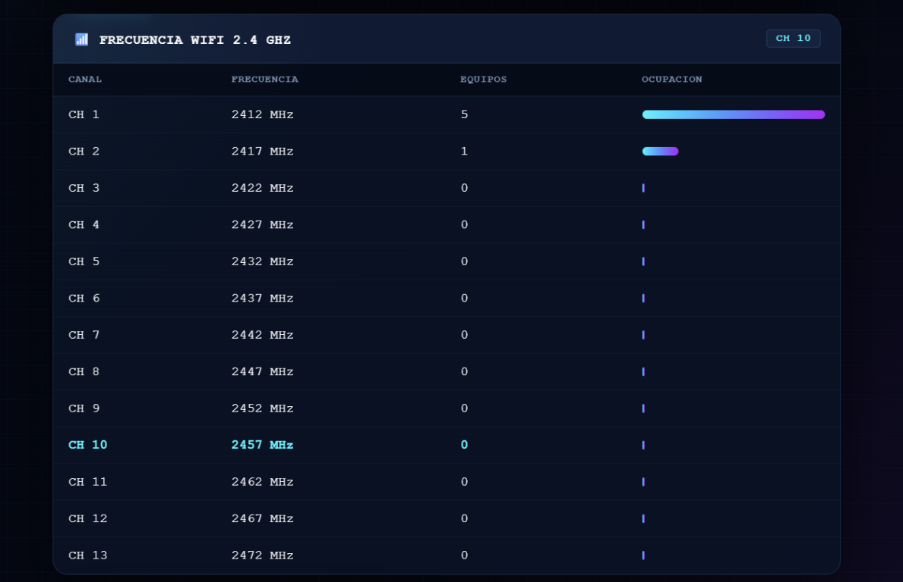
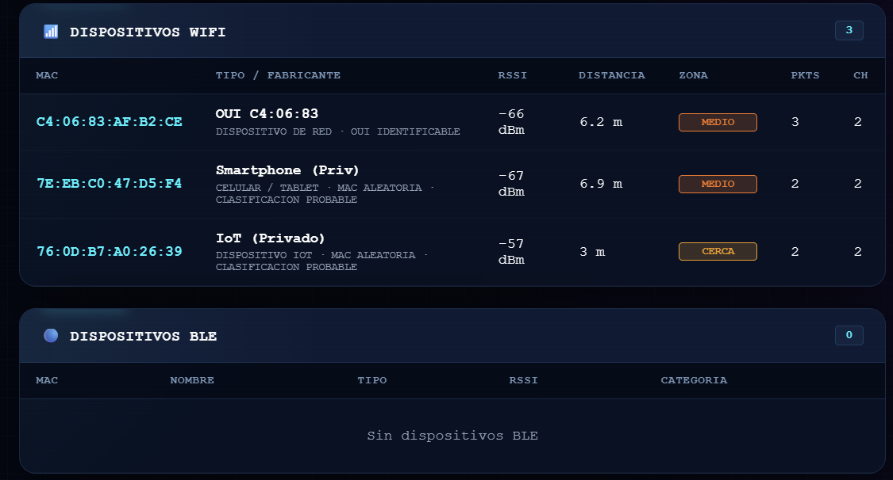
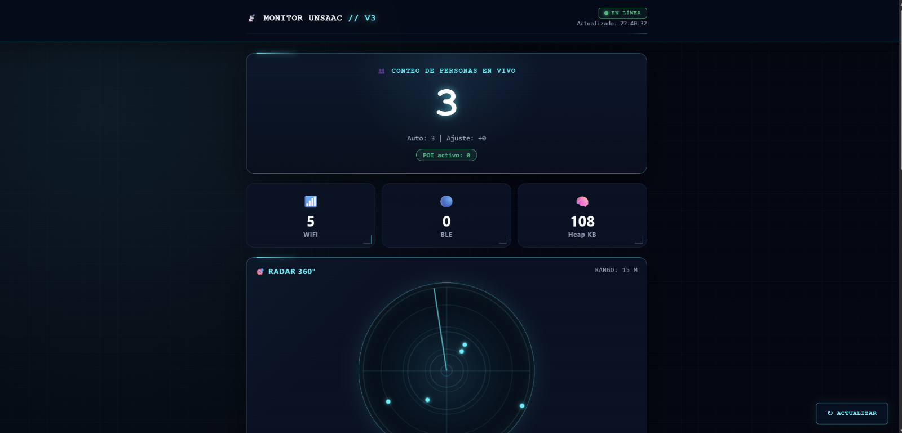

# Sistema integrado de detección electrónica y aforo UNSAAC


Proyecto académico desarrollado por **Hernan Washington Ramos Alata** que integra dos soluciones complementarias en un único sistema embebido:

1. **Detección de dispositivos electrónicos** mediante Wi-Fi promiscuo y Bluetooth Low Energy.
2. **Estimación de aforo de personas** mediante conteo indirecto de dispositivos activos y ajuste manual.

El proyecto fue diseñado para ambientes interiores controlados y utiliza un microcontrolador ESP32, AWS IoT Core, MQTT sobre TLS, AWS Lambda, DynamoDB, API Gateway y un dashboard web.

---

## Vista general

El ESP32 realiza la captura del espectro 2.4 GHz, calcula valores aproximados de proximidad y clasifica dispositivos conocidos o probables. Luego publica el estado cada ciclo a AWS. La información se almacena, se consulta desde API Gateway y se muestra en tiempo real en un dashboard diseñado para computadora y celular.

```text
Fase 1 — Wi-Fi promiscuo
  Escaneo de canales 1–13
  Captura de tramas
  Extracción de MAC, RSSI y canal
  Clasificación por OUI y huella de trama

Fase 2 — Bluetooth Low Energy
  Escaneo activo
  Detección de nombres y datos del fabricante
  Identificación probable de audífonos y accesorios

Fase 3 — Publicación AWS
  JSON completo
  MQTT sobre TLS
  Lambda
  DynamoDB
  API Gateway
  Dashboard web
```

---

## Proyecto I: detección de dispositivos electrónicos

Este módulo identifica:

- MAC o dirección observada;
- fabricante probable;
- categoría celular, laptop, computadora o IoT;
- RSSI filtrado;
- distancia aproximada;
- zona inmediato, cerca, medio o lejos;
- cantidad de paquetes;
- canal Wi-Fi;
- nombres y tipos de dispositivos BLE;
- ocupación aproximada por canales 2.4 GHz.

### Técnicas implementadas

- modo promiscuo IEEE 802.11;
- salto de canales Wi-Fi;
- detección de MAC administrada localmente;
- clasificación por OUI;
- análisis básico de Elementos de Información;
- filtro escalar de Kalman;
- modelo logarítmico Path Loss;
- escaneo BLE activo;
- radar táctico 360°;
- tablas de frecuencia y dispositivos;
- multiplexación temporal Wi-Fi/BLE/publicación.

### Modelo de proximidad

El sistema estima distancia mediante:

```text
d = 10 ^ ((-A - RSSI) / (10 * n))
```

Valores iniciales utilizados:

- `A = -45 dBm`;
- `n = 2.7`;
- distancia máxima mostrada: `15 m`.

El resultado depende del entorno y no constituye una posición exacta. En interiores, muros, cuerpos, antenas, orientación y multitrayecto pueden producir variaciones grandes.

### Ejemplo de tabla Wi-Fi

La tabla muestra el fabricante probable, RSSI, distancia estimada, zona, cantidad de paquetes y canal:

| Tipo | MAC | Ejemplo de resultado |
|---|---|---|
| OUI reconocido | `C4:06:83:AF:B2:CE` | OUI identificable |
| MAC aleatoria | `76:0D:B7:A0:26:39` | Celular, laptop o IoT probable |
| BLE | Dirección BLE | Nombre, tipo, fabricante y categoría |

La marca exacta no puede garantizarse cuando la dirección es aleatoria.

---

## Proyecto II: conteo y aforo de personas

Este módulo convierte los dispositivos activos en una estimación aproximada de ocupación.

### Fórmula actual

```text
Dispositivos totales = dispositivos Wi-Fi activos + dispositivos BLE activos
Estimación automática = redondeo(dispositivos totales / 1.5)
Aforo mostrado = máximo(0, estimación automática + ajuste manual)
```

Si existe al menos un dispositivo detectado y el cálculo devuelve cero, el sistema establece automáticamente una persona como mínimo.

La relación `1.5` es una referencia inicial tomada de estudios con entornos universitarios. No representa una constante universal. Debe calibrarse con mediciones reales en el recinto.

### Ajuste manual

El dashboard permite modificar el resultado mediante botones `+` y `-`. La petición `POST /adjust` envía el delta a AWS Lambda.

Lambda:

1. actualiza el ajuste manual de forma atómica;
2. conserva el valor en DynamoDB;
3. recalcula el total;
4. publica el ajuste por MQTT;
5. devuelve el nuevo estado a la interfaz.

### Limitaciones del aforo

El sistema puede sobreestimar porque:

- una persona puede llevar varios equipos;
- existen routers, impresoras y otros equipos fijos;
- una MAC aleatoria puede aparecer como varias;
- un accesorio BLE no representa obligatoriamente una persona.

Puede subestimar cuando:

- la persona no usa Wi-Fi o BLE;
- el dispositivo está apagado o en modo avión;
- el dispositivo permanece silencioso;
- el equipo está fuera del alcance.

El resultado debe presentarse como **aforo estimado**, no como conteo individual exacto.

---

## Arquitectura AWS

```text
ESP32
  ├── 25 segundos: captura Wi-Fi
  ├── 8 segundos: escaneo BLE
  └── 7 segundos: conexión y publicación MQTT
             |
             v
        AWS IoT Core
             |
             v
         IoT Rule
             |
             v
      AWS Lambda Python
             |
             v
          DynamoDB
             |
             v
        API Gateway REST
             |
             v
       Dashboard HTML
```

### Tópicos MQTT

| Tópico | Dirección | Contenido |
|---|---|---|
| `unsaac/esp32/scan` | ESP32 → AWS | Telemetría completa |
| `unsaac/esp32/adjust` | AWS → ESP32 | Ajuste manual `+1` o `-1` |

### Endpoints REST

| Método | Ruta | Función |
|---|---|---|
| `GET` | `/data` | Obtiene el último estado |
| `POST` | `/adjust` | Actualiza el ajuste manual |
| `OPTIONS` | Recursos API | Respuesta CORS |

---

## Estructura del repositorio

```text
.
├── firmware/
│   └── proyecto_esp32_v3.ino
├── backend/
│   └── lambda_function.py
├── dashboard/
│   └── index.html
├── docs/
│   ├── GUIA_AWS.md
│   └── images/
├── informes/
│   ├── Informe_I_Deteccion_Dispositivos_Electronicos.pdf
│   ├── Informe_I_Deteccion_Dispositivos_Electronicos.tex
│   ├── Informe_II_Conteo_Aforo_Personas.pdf
│   └── Informe_II_Conteo_Aforo_Personas.tex
├── README.md
└── .gitignore
```

---

## Capturas de funcionamiento

### Tabla de frecuencias Wi-Fi

Muestra los canales 1–13 de 2.4 GHz, frecuencia central, cantidad de equipos detectados y ocupación relativa.



### Dispositivos Wi-Fi y BLE

Presenta MAC, clasificación, RSSI, distancia, zona, paquetes y canal. Los dispositivos BLE se muestran en una tabla independiente.



### Aforo y radar 360°

Presenta el conteo de personas, ajuste manual automático, memoria disponible, equipos Wi-Fi/BLE y posicionamiento relativo en el radar.



---

## Informes académicos

### Informe I: detección de dispositivos electrónicos

Incluye antecedentes, fundamento físico, modelo RSSI, filtro Kalman, MAC aleatoria, OUI, BLE, arquitectura AWS, clasificación, evaluación, privacidad y mejoras futuras.

- [PDF del Informe I](informes/Informe_I_Deteccion_Dispositivos_Electronicos.pdf)
- [Código LaTeX del Informe I](informes/Informe_I_Deteccion_Dispositivos_Electronicos.tex)

### Informe II: conteo y aforo de personas

Incluye antecedentes, fórmula de conteo, riesgos de sobreconteo y subconteo, ajuste manual, métricas MAE/RMSE/MAPE, sincronización AWS y protocolos de validación.

- [PDF del Informe II](informes/Informe_II_Conteo_Aforo_Personas.pdf)
- [Código LaTeX del Informe II](informes/Informe_II_Conteo_Aforo_Personas.tex)

---

## Hardware utilizado

- placa ESP32 con Wi-Fi y Bluetooth;
- antena integrada;
- puerto USB para alimentación y monitor serie;
- red Wi-Fi de 2.4 GHz;
- AWS IoT Core;
- DynamoDB;
- Lambda;
- API Gateway;
- navegador web.

### Librerías Arduino

- `PubSubClient`;
- `ArduinoJson` versión 6;
- `WiFi.h`;
- `WiFiClientSecure.h`;
- `BLEDevice.h`;
- `BLEScan.h`;
- `esp_wifi.h`.

### Esquema de partición recomendado

Seleccionar una partición con aplicación suficientemente grande, por ejemplo:

```text
Huge APP (3 MB No OTA/1 MB SPIFFS)
```

---

## Configuración local

El repositorio no incluye secretos. Antes de usar el firmware:

1. Reemplazar `TU_WIFI_SSID`.
2. Reemplazar `TU_WIFI_PASSWORD`.
3. Reemplazar `TU_ENDPOINT-ats.iot.REGION.amazonaws.com`.
4. Insertar el certificado Amazon Root CA localmente.
5. Insertar el certificado del dispositivo.
6. Insertar la clave privada sin publicarla.
7. Configurar `IOT_ENDPOINT` en Lambda.
8. Configurar `DYNAMO_TABLE`.
9. Configurar `API_BASE` con la URL de API Gateway.
10. Crear la tabla DynamoDB `ESP32Scan`.

No subir `.pem`, `.key`, `.crt`, contraseñas o identificadores reales.

---

## Ejecutar el dashboard localmente

```powershell
cd dashboard
python -m http.server 8080
```

Abrir:

```text
http://localhost:8080
```

Para publicar en S3, subir `dashboard/index.html` y configurar el bucket como sitio web estático.

---

## Validación recomendada

### Detección

- medir distancia en línea de vista;
- repetir con paredes y obstáculos;
- registrar MAE y RMSE;
- comparar MAC reales y aleatorias;
- confirmar clasificación BLE;
- documentar error por zona.

### Aforo

- definir verdad terreno;
- probar ocupaciones controladas;
- registrar entradas y salidas;
- repetir con 0, 5, 10, 15 y 20 personas;
- calcular MAE, RMSE y MAPE;
- comparar el ajuste manual contra el conteo automático.

---

## Privacidad y seguridad

Este proyecto debe utilizarse exclusivamente en ambientes autorizados.

- informar a las personas presentes;
- no publicar direcciones MAC completas;
- minimizar la retención de datos;
- no utilizar RSSI para vigilancia individual;
- no presentar la clasificación como identidad exacta;
- restringir Lambda, DynamoDB, IoT y API Gateway;
- eliminar datos experimentales al finalizar las pruebas.

---

## Autor

**Hernan Washington Ramos Alata**

Universidad Nacional de San Antonio Abad del Cusco

---

## Estado del proyecto

- Firmware Wi-Fi y BLE operativo.
- Filtro RSSI implementado.
- Clasificación OUI implementada.
- Ajuste manual implementado.
- Dashboard responsive funcional.
- MQTT y AWS configurables.
- Informes PDF y LaTeX incluidos.
- Validación cuantitativa pendiente en el entorno real.
